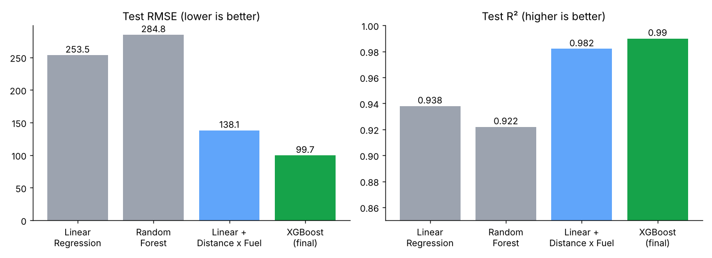
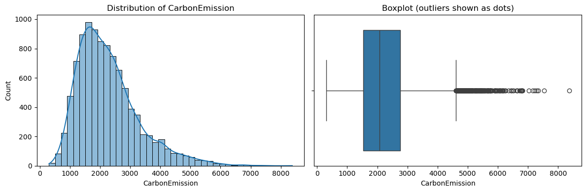
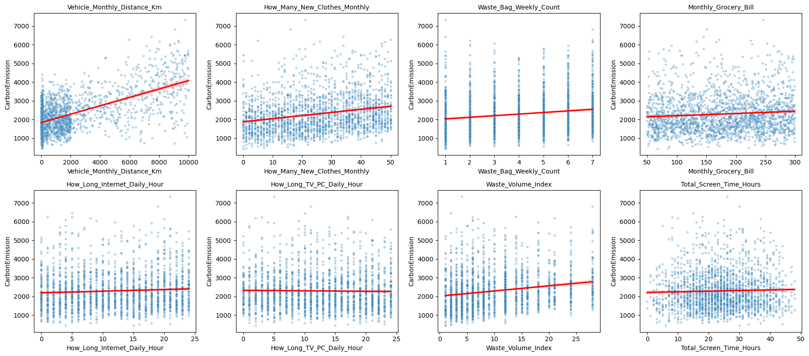
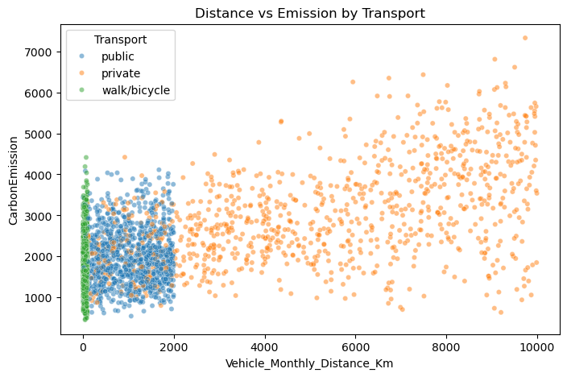
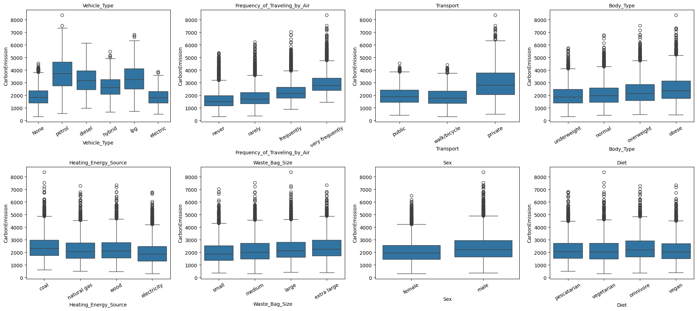
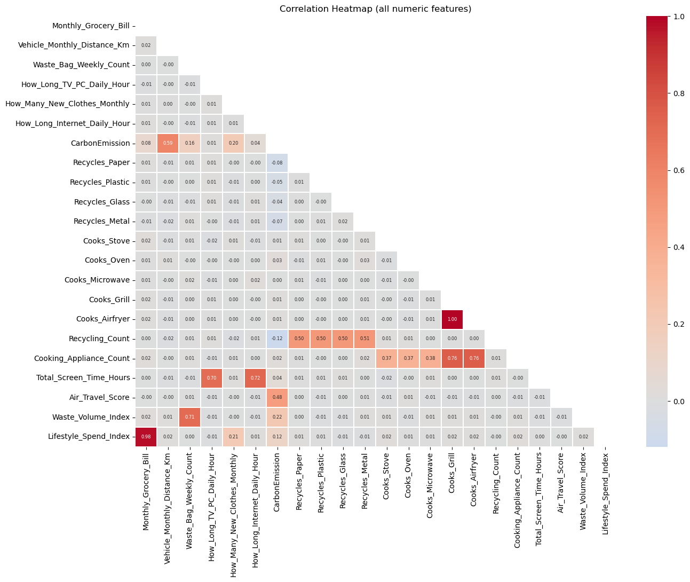
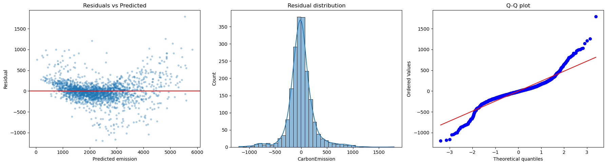
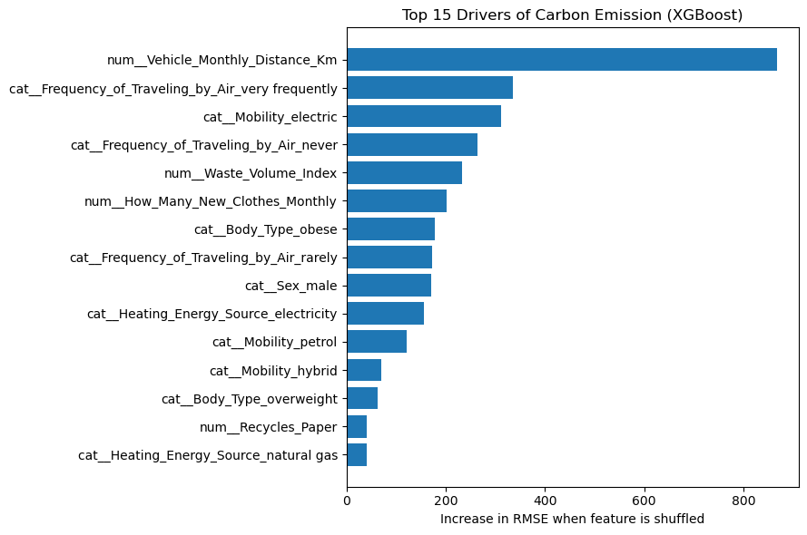

# 🌍 Individual Carbon Emission Prediction

End-to-end machine learning regression project that predicts a person's carbon footprint from lifestyle habits, explains the main drivers, and estimates the effect of realistic habit changes.



**Final model:** XGBoost, **R² = 0.990**, **RMSE ≈ 99.7**, **MAE ≈ 73.6** on a held-out test set (about 60% lower error than the linear baseline).

---

## Table of contents
1. [Problem statement](#problem-statement)
2. [Dataset](#dataset)
3. [Project workflow](#project-workflow)
4. [Key findings](#key-findings)
5. [Model results](#model-results)
6. [Sustainability recommendations](#sustainability-recommendations)
7. [Repository structure](#repository-structure)
8. [How to run](#how-to-run)
9. [Limitations](#limitations)
10. [Future work](#future-work)

---

## Problem statement

Emissions from individuals and households are driven by many everyday choices: how we travel, fly, heat our homes, shop and dispose of waste. Policy makers, sustainability teams and individuals do not know **which habits matter most** or **how much a specific change would save**.

**Goal:** build a regression model that predicts an individual's `CarbonEmission` from 19 lifestyle features, then use it to:
1. identify the strongest emission drivers,
2. compare linear and non-linear models and explain why one wins,
3. estimate the effect of realistic habit changes.

**Success criteria:** test R² above 0.90, no large train/test gap, sound handling of data-quality issues, and recommendations backed by the model.

---

## Dataset

| Item | Detail |
|---|---|
| Size | 10,000 people x 20 columns |
| Target | `CarbonEmission` (continuous; unit not stated in the dataset), range 306 to 8,377, mean about 2,269 |
| Numeric inputs | Monthly grocery bill, vehicle distance (km/month), waste bags per week, TV/PC hours, new clothes per month, internet hours |
| Categorical inputs | Body type, sex, diet, shower frequency, heating source, transport, vehicle type, social activity, air travel frequency, waste bag size, energy efficiency |
| Multi-value text | `Recycling`, `Cooking_With` (e.g. `['Paper', 'Glass']`) |
| Data quality | No duplicates; only `Vehicle_Type` has blanks (67.2%), and they are meaningful |

> Place the CSV in `data/` and update the path in the first notebook cell.

---

## Project workflow

`Load & clean` → `Quality checks` → `EDA` → `Feature engineering` → `Preprocessing & split` → `Baseline Linear Regression` → `Diagnostics (residuals, VIF)` → `Fixes` → `Ridge / Lasso` → `Random Forest / XGBoost` → `Tuning` → `Feature importance` → `What-if analysis` → `Save pipeline`

**Main steps**
- **Data quality:** blank `Vehicle_Type` means "no private vehicle" (it is blank for every public-transport and walking row), so it was filled with the category `None`, not deleted or guessed.
- **Feature engineering:** `Recycling` and `Cooking_With` converted to binary flags and counts; composite features `Total_Screen_Time_Hours`, `Air_Travel_Score`, `Waste_Volume_Index`, `Lifestyle_Spend_Index`.
- **Preprocessing:** median/most-frequent imputation, standard scaling, one-hot encoding, all fitted on the training set only.
- **Diagnostics:** residual plots, Breusch-Pagan, Jarque-Bera, Durbin-Watson and VIF.
- **Models:** Linear, Ridge, Lasso, Random Forest, XGBoost, plus a linear model with Distance x Fuel interactions.

---

## Key findings

### 1. The target is right-skewed
Most people emit a moderate amount while a few heavy emitters pull the average up.



### 2. Distance is the strongest numeric driver, but the spread widens
Emissions rise with distance (r = 0.59), and the fan shape hints at unequal variance.



### 3. Fuel type changes the price of every kilometre
Private-vehicle users dominate the high-distance, high-emission region.



### 4. Vehicle fuel type and air travel separate people sharply
Petrol drivers and very frequent flyers sit highest; electric-vehicle owners emit about as little as people with no vehicle.



### 5. Engineered features created duplicates
Several composite features are exact copies or sums of others (VIF = infinity), so they were removed for linear models.



### 6. A straight line misses the curve
The linear baseline scores well (R² 0.938) but its residuals form a smile shape and widen for high predictions, a sign of missing interactions.



### 7. What drives emissions in the final model
Permutation importance shows distance, air travel and vehicle fuel type as the top drivers.



---

## Model results

| Model | Test R² | Test RMSE | Test MAE | Note |
|---|---|---|---|---|
| Linear Regression | 0.938 | 253.5 | 164.9 | Strong baseline; assumptions fail |
| Linear on log(target) | 0.887 | 343.0 | 197.5 | Fixed the funnel, hurt accuracy |
| Ridge / Lasso | 0.938 | 253.4 | 164.9 | Same as linear; nothing to regularise |
| Random Forest | 0.922 | 284.8 | 215.4 | Overfits |
| Linear + Distance x Fuel | 0.982 | 138.1 | 99.0 | Best explainable model, no overfit |
| Simpler XGBoost (36 columns) | 0.990 | 101.8 | 75.9 | Almost as accurate, fewer inputs |
| **XGBoost (final)** | **0.990** | **99.7** | **73.6** | **Best accuracy** |

**Why XGBoost wins:** each tree corrects the previous errors, so it learns both the smooth additive trend and interactions such as distance x fuel type.

**Extra emission per +1,000 km (interaction linear model):** petrol 372, LPG 273, diesel 246, hybrid 164, public 64, electric about 0.

---

## Sustainability recommendations

Average predicted drop per affected person (what-if analysis on test rows):

| Habit change | Avg drop | % of avg emission |
|---|---|---|
| Fossil car → electric | 1,507 | 65.8% |
| Very frequent flyers → rarely | 1,105 | 48.2% |
| Coal/wood heat → electricity | 329 | 14.4% |
| Drive 30% less | 322 | 14.1% |
| Start recycling paper | 141 | 6.2% |
| Buy 10 fewer clothes/month | 138 | 6.0% |

Showers, diet tweaks, cooking appliances and waste-bag size had little effect in this dataset.

---

## Repository structure

```
carbon-emission-prediction/
├── data/
│   └── carbon_emission.csv
├── notebooks/
│   └── carbon_emission_prediction.ipynb
├── images/                  # charts used in this README
├── models/
│   └── carbon_emission_xgb.joblib
├── requirements.txt
└── README.md
```

---

## How to run

```bash
git clone https://github.com/<your-username>/carbon-emission-prediction.git
cd carbon-emission-prediction
pip install -r requirements.txt
jupyter notebook notebooks/carbon_emission_prediction.ipynb
```

**Use the saved model**
```python
import joblib
model = joblib.load("models/carbon_emission_xgb.joblib")
# new_data needs the same columns as the training features, including "Mobility"
# (fuel type if the person drives privately, otherwise "public" or "walk/bicycle")
prediction = model.predict(new_data)
```

**requirements.txt**
```
pandas
numpy
matplotlib
seaborn
scikit-learn
scipy
statsmodels
xgboost
joblib
```

---

## Limitations
- What-if results are **model predictions, not proven causal effects**.
- Savings from several changes **will not simply add up**, because of interactions.
- The dataset does not state the **unit** of `CarbonEmission`.
- Feature distributions look uniform, so the data may be synthetic or survey-based; real-world performance may differ.
- XGBoost shows some train/test gap (about 30 RMSE units); the test score is still strong.

## Future work
- SHAP explanations for per-person predictions.
- Cross-validated hyperparameter search.
- More interaction features (air travel x other habits) for the linear model.
- A small web app (Streamlit) on top of the saved pipeline.

---

## Author
**Nazmin Ansari** · [LinkedIn](www.linkedin.com/in/nazmin-ansari-69357831a),[GitHub](https://github.com/Nazmin4787)
